# Fibril interface passivation and clearance reshape bistability in a network model of amyloid associated damage

**Running head:** Interface occupancy and amyloid associated damage

Author A. Name¹, Author B. Name²,*

¹ Department, Institution, City, Country

² Department, Institution, City, Country

* Corresponding author: name and email to be supplied

## Abstract

Fibril surfaces catalyse the generation of toxic amyloid-β oligomers, providing a molecular target complementary to aggregate clearance. We formulate a continuous-time network model coupling monomer, oligomer and fibril burdens to passivator concentration, interface occupancy and a reversible damage index. Surface-mediated nucleation and elongation decrease with the free-interface fraction. A frozen-monomer linearisation gives an amplification threshold of 0.547 for the reference occupancy; this is an approximation to a reduced subsystem, rather than an exact stability boundary of the complete model. Resolving monomer depletion and damage feedback yields two saddle-node folds at occupancies 0.9282 and 0.9902, with stable low- and high-damage equilibria coexisting between them. An analytic elimination of the fast aggregation variables removes numerical gaps in the quasi-steady reduction and permits continuous reconstruction of the damage landscape. Simulations distinguish short-horizon improvement from sustained suppression: at the reference intervention, mean damage at time 200 is 0.663 under passivation, 0.725 under clearance enhancement and 0.093 under their combination, versus 0.912 untreated. Matched-dose comparisons quantify departure from Bliss independence within the simulated dose grid. Global sensitivity analysis identifies monomer supply and local aggregation kinetics as the principal controls on aggregate outcomes, while network geometry shapes regional onset. A synthetic fitting benchmark recovers six parameters within 10.9% but does not establish clinical identifiability. These results motivate occupancy- and timing-dependent experimental tests of combined surface inhibition and clearance. The dimensionless, phenomenological model provides testable hypotheses rather than patient-specific dose recommendations.

**Keywords:** Alzheimer's disease; amyloid-β; secondary nucleation; interface occupancy; bistability; combination therapy; network dynamics

## 1. Introduction

Amyloid-β (Aβ) aggregation is a central component of Alzheimer's disease (AD), alongside tau pathology, neuroinflammation and neuronal dysfunction [1,2,3,4]. The amyloid cascade hypothesis has motivated extensive investigation of how peptide production, self-assembly and clearance contribute to disease [1,2]. Aggregation proceeds through a reaction network involving primary nucleation, elongation and multiplication of existing aggregates [5,6,7,8]. For Aβ42 under experimentally studied conditions, fibril surfaces catalyse secondary nucleation and thereby generate new oligomeric species [9,10]. These observations make the fibril interface a potential intervention target rather than a passive marker of accumulated pathology.

Clinical trials of anti-Aβ antibodies demonstrate that aggregate removal can modify biomarkers and slow measured decline in selected early-stage populations, while leaving substantial unmet need [11,12,13,14]. A complementary approach is to reduce the generation of toxic species. Aggregation inhibitors can act at different microscopic steps, with different consequences for oligomer exposure [15,16]. EGCG can remodel mature fibrils or redirect aggregation into off-pathway assemblies [17,18]; these processes are more complex than simple surface occupation. A more direct precedent for catalytic-surface inhibition is the BRICHOS domain, which binds fibril surfaces and suppresses the formation of toxic Aβ oligomers [19]. We use the term interface passivation for an idealised occupancy mechanism that reduces the activity of surface reactions. We do not assume that all inhibitors share this mechanism or that side binding necessarily blocks fibril ends.

Mathematical models address complementary scales of AD. Differential-equation models have examined interactions between Aβ, neurons and inflammatory cells, while aggregation and transport models have coupled protein assembly to neuronal malfunction [20,21,22]. Brain-network approaches relate connectivity to spatial patterns of degeneration and protein propagation [23,24,25,26,27,28]. Such models already combine local reactions with network transport, so an aggregation-resolved network description is not itself a new concept. Data-driven progression models, including Subtype and Stage Inference and tau-deposition trajectories, address heterogeneity and temporal ordering from a different perspective [29,30]. The question considered here is narrower: how does explicit fibril-interface occupancy interact with clearance and damage feedback to alter the attractors and intervention response of a tractable network model?

This question requires separating several notions of efficacy. An inhibitor may reduce oligomer production, delay a rise in damage, create a low-damage equilibrium or move an established trajectory into that equilibrium's basin. These outcomes need not occur at the same occupancy or observation time. The long preclinical phase of AD further motivates examination of treatment onset [31,32], although model time cannot be interpreted as patient age without calibration. We therefore combine a frozen-monomer amplification calculation, numerical equilibrium analysis, long-horizon simulations and sensitivity analysis. The main contribution is an explicit connection between interface occupancy, bistability and the distinction between transient improvement and late damage suppression, together with reproducible numerical checks of that connection.

## 2. Model formulation

### 2.1 Network and state variables

Let A be a symmetric, nonnegative raw adjacency matrix and sᵥ its row strength. On a connected graph without isolated nodes, we set Wᵥᵤ = Aᵥᵤ/sᵥ and L = W − I. The row-normalised matrix W is generally asymmetric. Mixing acts as Dₓ(Lx)ᵥ and preserves spatially constant states. Its invariant measure is proportional to s: the strength-weighted sum is conserved under mixing alone, whereas the unweighted sum generally is not. This distinction matters when interpreting arithmetic network means. The operator represents averaging of regional burdens, rather than a physical mass-conserving flux between equal-volume compartments.

At each region v, the nonnegative variables Xᵥ, Yᵥ and Zᵥ represent monomer, toxic-oligomer and fibril burdens. Pᵥ denotes free passivator concentration, θᵥ the occupied-interface fraction and aᵥ a damage index, with θᵥ and aᵥ in [0,1]. Regional labels on the surrogate connectome follow the Desikan atlas convention [33], but the network is generated rather than measured. All simulations use dimensionless model units.

### 2.2 Local reactions and coupling

The six evolution equations are

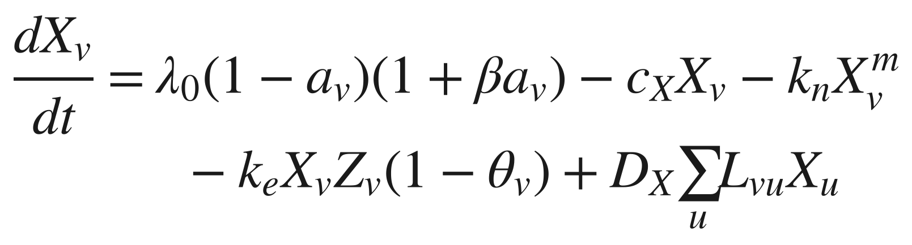

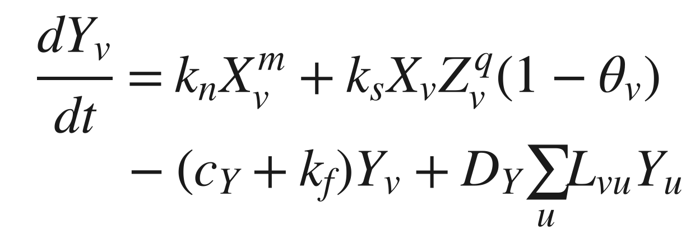

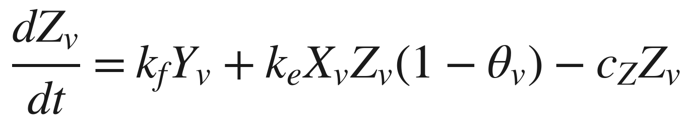

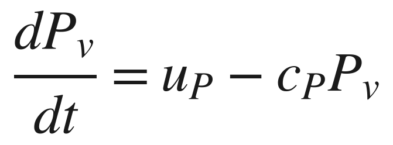

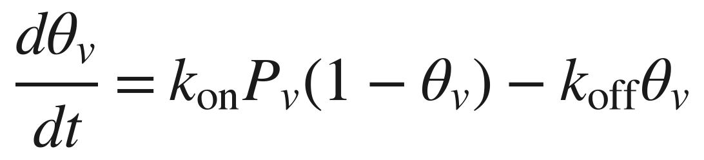

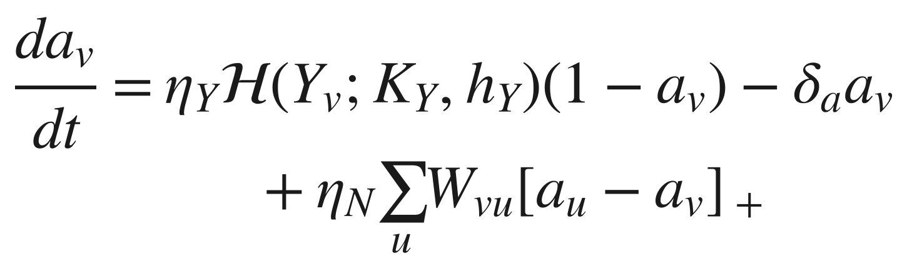

The toxicity function and the interface-activity readout are

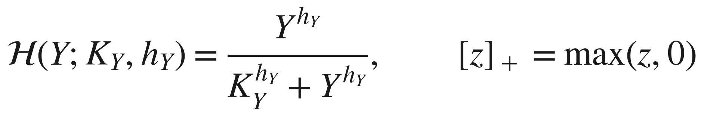

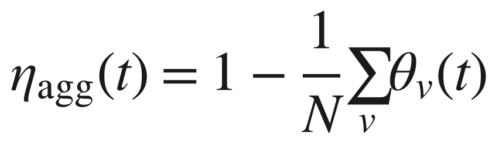

Primary nucleation transfers effective burden from X to Y at rate kₙXᵐ; conversion transfers Y to Z at rate kf Y. Elongation consumes monomer and increases fibril burden. Secondary nucleation creates oligomer burden in proportion to XZᵠ and the free-interface fraction. The monomer equation does not include a matching sink for this source. Consequently, X, Y and Z are phenomenological burdens rather than stoichiometrically resolved mass concentrations, and their sum is not a conserved peptide mass. A mass-balanced extension would require independently calibrated yields and monomer consumption for every nucleation pathway.

Damage modulates effective monomer supply through λ₀(1 − a)(1 + βa), which rises initially for β > 1 and falls as a approaches one. This phenomenological feedback combines increased effective supply or retention with loss of viable production capacity. It does not identify a particular failed-clearance pathway. The damage-coupling term transmits influence from neighbours with greater damage, because [aᵤ − aᵥ]₊ is positive only when aᵤ > aᵥ. Repair makes a a reversible index; decreases in a should not be interpreted as regeneration of dead neurons. Figure 1 summarises the model.

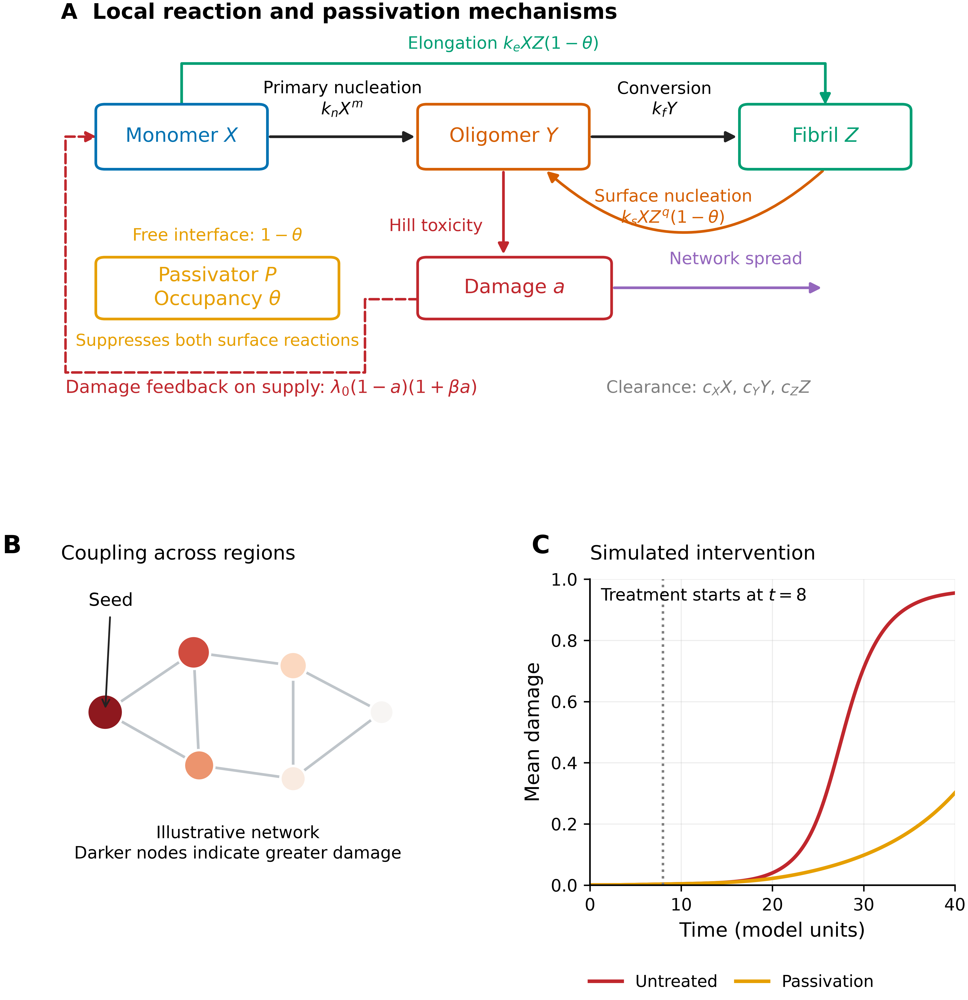

**Figure 1.** Model structure. (A) Primary nucleation, conversion, elongation and fibril-surface nucleation connect the three burden variables; occupancy θ suppresses both surface reactions. Oligomer exposure drives the damage index, which feeds back on supply and couples across regions. This shared occupancy is a modelling assumption. (B) Illustrative network, with darker nodes indicating greater damage; this panel is a schematic rather than a simulation result. (C) Simulated network-mean damage with and without passivation starting at t = 8, using the reference dose uP = 0.012.

The nonnegative state domain is forward invariant: at a zero burden, its production and mixing terms are nonnegative. Occupancy points inward at θ = 0 and θ = 1. Damage points inward at a = 0; at a = 1 the nonlocal positive-part term vanishes and repair points inward. For q = 1, monomer is bounded above by its maximum supply divided by cX, using the maximum principle for row-normalised mixing. The remaining burden equations then admit at most exponential growth on any finite interval. These properties support finite-time integration; they do not imply mass conservation or a global stability theorem.

### 2.3 Binding and occupancy

At fixed free passivator concentration, Eq. (5) gives the Langmuir occupancy

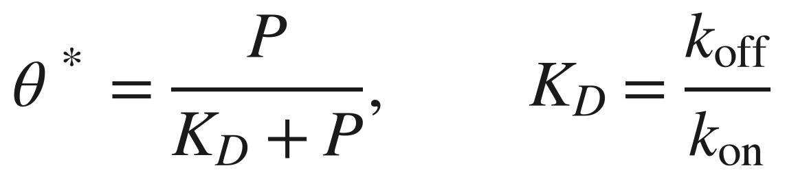

For sustained infusion, P* = uP/cP. The reference dissociation constant is KD = 0.15, giving θ* = 0.80 at uP = 0.012. Binding relaxes at rate k_on P + k_off, while P accumulates on the slower timescale 1/cP = 50. Time-dependent simulations retain both equations. The free-passivator equation neglects depletion by binding and is appropriate only when the free pool can be treated as an externally maintained reservoir. Likewise, suppression of end growth and side-surface nucleation by one occupancy variable is an idealisation to be tested for a selected molecule.

### 2.4 Frozen-pool amplification threshold

Define the reference monomer scale Xs = λ₀/cX = 0.786. This is the production-clearance balance with aggregation omitted, rather than the exact monomer equilibrium of the full model. For q = 1, holding X = Xs and a = 0 and neglecting the nonzero primary-nucleation source gives the linear oligomer-fibril subsystem

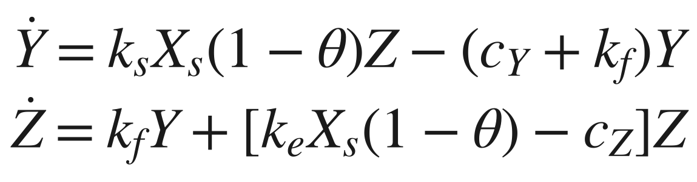

Its homogeneous amplification matrix is stable when its determinant is positive; the determinant inequality also ensures a negative trace. The corresponding composite gain and occupancy threshold are

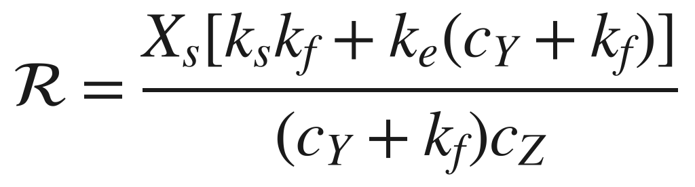

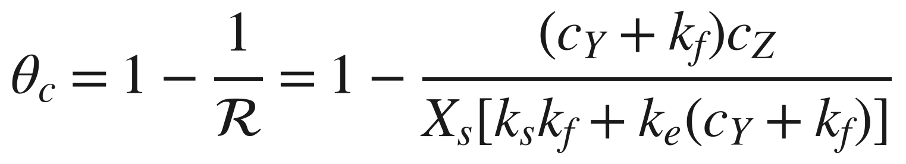

The reference values are ℛ = 2.21 and θc = 0.547. If ℛ ≤ 1, the frozen-pool amplification condition is already satisfied at zero occupancy. This calculation is exact for the stated homogeneous linear subsystem. It is not an exact disease-free stability criterion for Eqs. (1)–(6), because kₙ > 0 continuously generates oligomer, monomer depletes and damage changes supply. We therefore use θc as a mechanistic comparator, not as a proven bound for arbitrary parameters or a sufficient treatment target. Increasing cY or cZ reduces this approximate threshold; the effect of kf is parameter-dependent because conversion removes oligomer while also generating catalytic fibril. For kₛ > kₑcY, as at the reference point, increasing kf increases ℛ and raises θc.

### 2.5 Quasi-steady elimination and bistability

For q = 1, the fast equilibrium at fixed damage and occupancy can be reduced analytically. Let C = cY + kf and b = 1 − θ. The oligomer and fibril balances give

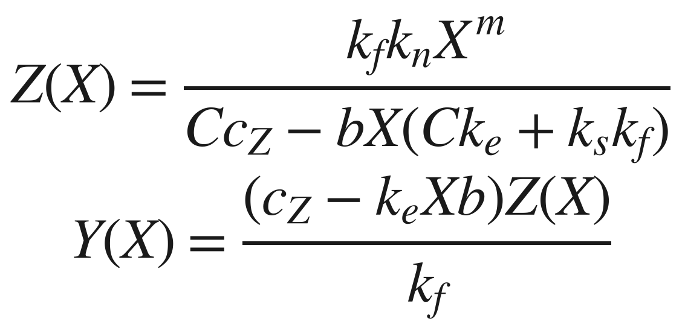

For b > 0, positivity restricts X below the pole CcZ/[b(Ckₑ + kₛkf)]. Substitution into the monomer balance yields a strictly decreasing scalar function, positive at X = 0 and negative before the pole or at the supply-clearance upper bound. It therefore has a unique physical root for 0 ≤ a < 1 when the reference positive reaction rates are used. At a = 1 the equilibrium is zero. At b = 0 the same balance reduces smoothly to the primary-nucleation case. There is consequently no missing quasi-steady branch at the reference q = 1: failure of an unconstrained multidimensional root search cannot establish nonexistence of a fast equilibrium.

Substituting the fast equilibrium into Eq. (6) defines a scalar drift f(a;θ). We use its roots to initialise full four-variable equilibria and define a reduced potential

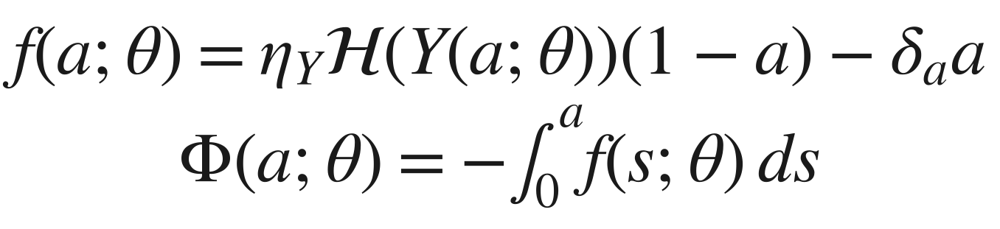

This scalar potential is a visualisation of reduced deterministic dynamics, not a thermodynamic free energy or a potential for the full network. Its extrema identify reduced equilibria; stability of the complete node is checked separately. Fold points satisfy f = 0 and ∂f/∂a = 0. Comparing both folds, rather than only the appearance of a low-damage root, establishes the bistable interval.

## 3. Numerical methods

### 3.1 Graphs and initial conditions

We use a 20 × 20 sheet with eight-neighbour distance-weighted edges, a 68-node small-world control and a 68-region surrogate connectome. The small-world construction is inspired by Watts–Strogatz rewiring [34]; the implementation symmetrises rewired geometric weights, so its final degree is not constrained to equal the nominal ring degree. The surrogate connectome combines distance-dependent connection probabilities, reinforced association-region hubs, attenuated interhemispheric connections and random long-range edges. Its mean degree is 14.41, density 0.215, clustering 0.535 and mean shortest-path length 2.129. These are construction descriptors, not evidence of validation against an individual human connectome.

The sheet seed is node 105, with a = 0.15, Y = 0.05 and Z = 0.08; other nodes begin with zero Y, Z and a. Initial monomer burden is X = 0.03 throughout. Connectome simulations seed the left and right entorhinal regions. This choice is motivated by regional vulnerability literature [35,36] but partly imposes the ensuing medial-temporal ordering. In particular, tau-related staging evidence does not validate simulated Aβ burden or damage trajectories.

### 3.2 Integration and equilibrium verification

The network equations are integrated with LSODA, relative tolerance 10⁻⁷ and absolute tolerance 10⁻⁹. Reference trajectories cover t ∈ [0,40] with 1201 output points; extended scans cover [0,200]. Negative intermediate values and excursions of occupancy or damage outside their domains are clipped in right-hand-side evaluation as a numerical safeguard. The scientific invariance argument above is independent of this safeguard. Parameter schedules apply constant changes after the specified onset. Reported outcomes describe these schedules, graph constructions and initial conditions.

For the q = 1 equilibrium analysis, bracketed scalar monomer solves are used at each fixed damage value. Roots of the reduced drift are refined and tested against the complete four-variable node equations with occupancy held fixed. Stability follows from the full numerical Jacobian, not from potential shape alone. Folds are refined by jointly solving f = 0 and its damage derivative. The maximum fast-equilibrium residual in a verification grid spanning three occupancies and 60 damage levels was 3.0 × 10⁻¹¹; sampled fast Jacobians had negative real eigenvalues. These checks support the reduction on the tested grid, without proving uniform timescale separation. Bistability trajectories are extended to t = 2000 to distinguish convergence from the earlier t = 120 transient.

### 3.3 Intervention protocols and outcome definitions

Passivation sets uP = 0.012; clearance enhancement sets cY = 0.50 and cZ = 0.20; primary-nucleation inhibition sets kₙ = 0.002; propagation inhibition sets DY = 0.02 and ηN = 0.05. The reference combination applies passivation and both clearance changes. Table 2 compares onset t = 8. Peak and integrated oligomer burdens in this table use [0,40]; damage is also reported at t = 200. A terminal value at t = 200 is a late-horizon endpoint and is not, by itself, proof of asymptotic arrest. We use prespecified damage contours of 0.14 for the onset-window illustration and 0.15 for the combination landscape as operational benchmarks, not clinical cutoffs.

The two-dimensional landscape varies cY and uP, while cZ remains at its baseline 0.114. This protocol differs from the three-parameter reference combination in Table 2 and must be interpreted separately. For each sampled combination coordinate we recompute matched single-agent controls at exactly the same dose and onset. The normalised damage benefit is E = 1 − ā(t = 200)/ā (untreated, t = 200). Bliss independence predicts

Excess is the simulated combination benefit minus this prediction. Bliss is a reference model for independent effects, not a statistical hypothesis test or an assumption that response surfaces must be smooth. In this deterministic model, positive excess supports departure from that reference within the specified dose grid; it does not establish clinical drug synergy. No p-value is attached to the fraction of sampled grid points with positive excess.

### 3.4 Sensitivity and regional association analyses

Global sensitivity follows Latin-hypercube sampling and partial rank correlation coefficients (PRCC) [37]. Four hundred samples vary 20 kinetic parameters over log-uniform one-third to threefold reference ranges, with narrower ranges for reaction orders. PRCC controls the remaining 19 ranked inputs; two-sided nominal p-values use 400 − 2 − 19 = 379 degrees of freedom. The analysis is exploratory, without multiplicity adjustment, and PRCC summarises monotone associations rather than interaction effects. Non-crossing times are coded at the horizon, so timing correlations contain ties and right-censoring. Untreated simulations cannot identify binding or infusion sensitivities when the passivator is absent.

Regional associations use the raw, unnormalised connectome to define strength, degree and eigenvector centrality. Using row-normalised strength would yield a constant and an invalid correlation. We compare onset at a = 0.3 with graph-hop and Euclidean distances, and examine partial correlations controlling these distances. Nominal p-values treat regions as independent; spatial dependence, the generated graph and a fixed seed configuration limit inference. These statistics describe the simulated network and should not be read as population-level brain findings.

### 3.5 Synthetic fitting benchmark

We generate 21 observation times over [0,40] for network-mean Y, Z and a from six perturbed parameters, adding independent Gaussian noise with standard deviation 0.03 times the larger of the instantaneous signal and 0.02, followed by nonnegative clipping. Six parameters are fitted jointly in log space with three starts and one-quarter to fourfold reference bounds. The existing fit scales each output by the larger of its observed maximum and 0.05; these are output-normalisation weights, not the heteroscedastic noise standard deviations. Solver tolerances during fitting are 10⁻⁵ and 10⁻⁷; the final fitted trajectory uses the reference tolerances.

We report recovery error, local Gauss–Newton standard errors and the associated parameter correlations. The intervals in Fig. 8C are exp[log(p̂) ± 1.96 SE(p̂)/p̂], displayed as descriptive local Gaussian approximations. The mismatch between fitting weights and the generative noise, one noise realisation, bounded fitting and local covariance preclude an established 95% coverage interpretation. A covariance matrix does not establish structural identifiability. Jointly reoptimised, noise-consistent profile likelihoods and repeated-noise coverage checks remain necessary for stronger uncertainty claims.

## 4. Results

### 4.1 Reference cascade dynamics

The untreated sheet simulation exhibits a lag followed by amplification and widespread high damage (Fig. 2). Network-mean oligomer peaks at 0.346 at t = 35.8; at t = 15 it is approximately 9% of that peak. Mean damage crosses 0.2, 0.5 and 0.8 at t = 24.7, 27.8 and 31.5, respectively. At t = 40, mean damage is 0.955 and all nodes exceed 0.8. The late untreated endpoint at t = 200 is lower, 0.912, because the reversible damage index relaxes after its transient overshoot. These phases are features of the selected model working point; their labels do not calibrate preclinical or clinical time in people.

The supply feedback reaches its maximum at a = (β − 1)/(2β) = 0.389. It therefore amplifies effective supply over part of the trajectory before loss of production capacity dominates. Primary nucleation initiates aggregation even in initially unseeded nodes, so spread from the seed and local initiation coexist. A seed-to-region onset association does not imply that every regional aggregate originated in the seed.

**Figure 2.** Reference dynamics. (A) Seed-region burdens and damage, with damage on the right axis. (B) Network means; shaded phases describe the simulated trajectories rather than calibrated disease stages. (C) Seed-region phase portrait with time markers. (D) Damage-modulated monomer supply and illustrative clearance levels cXX evaluated at X = 0.79 and 1.35; the latter lines are reference levels, not verified healthy and diseased equilibria. The vertical dotted line indicates maximum supply.

### 4.2 Spatial organisation and topology controls

In the surrogate connectome, damage emerges near the entorhinal seeds before reaching more distant regions (Fig. 3). Graph-hop distance predicts onset (r = 0.81, nominal p = 4 × 10⁻¹⁷); after controlling Euclidean distance, the partial correlation is 0.60 (p = 8 × 10⁻⁸). Raw weighted strength is positively associated with onset time (r = 0.38, p = 0.001; partial r = 0.31, p = 0.013 after controlling both distances), while its correlation with terminal damage is approximately 0.02 (p = 0.90). Thus, in this construction, greater strength is associated with slightly later onset and provides little information about a nearly saturated endpoint. This does not establish absence of hub vulnerability in AD, nor does it rule out a role for network propagation.

Aggregate outcomes vary modestly across the three tested constructions: sheet, small-world and surrogate-connectome oligomer peaks are 0.346, 0.321 and 0.302; damage at t = 40 is 0.955, 0.955 and 0.959; and the 0.5 damage crossings occur at 27.8, 27.2 and 25.6. These comparisons support limited dependence of these aggregate endpoints on the selected topologies. The networks differ in size and initial seed fraction and do not constitute an ensemble of real connectomes. Spatial patterning, transport normalisation and endpoint saturation remain relevant even when arithmetic network means are similar.

**Figure 3.** Spatial dynamics on the generated 68-region connectome. (A–D) Snapshots at t = 4, 10, 18 and 28; node colour and size encode damage. (E) Region-by-time heat map ordered by onset. (F) Mean damage in the three topology controls. (G) Raw weighted strength versus terminal damage and onset time; inferential statistics are descriptive because nodes are spatially dependent. (H) Onset times for the earliest 14 labelled regions. Entorhinal seeding is imposed by the initial conditions.

### 4.3 Two folds and a continuous reduced landscape

The refined node equilibria reveal a bistable interval bounded by θ = 0.928210 and θ = 0.990198 (Fig. 4A; Supplementary Fig. S1). At the lower fold, a low-damage attractor and an unstable saddle appear at a = 0.0455. At the upper fold, the high-damage attractor and the saddle collide at a = 0.2718. The interval width is 0.06199. Below the lower fold only the high-damage equilibrium is found; above the upper fold only the low-damage equilibrium is found on the scanned physical branch. The numerical Jacobian has one eigenvalue close to zero at each fold, with the other real parts negative.

The frozen-pool comparator θc = 0.547 lies substantially below the lower fold. Their separation is 0.381 at the reference point and approximately 0.35–0.38 across the tested clearance range (Fig. 4B). This separation summarises the consequences of changing from a source-free, frozen-monomer linear subsystem to the coupled nonlinear model. It cannot be attributed exclusively to damage feedback without a separate ablation, because primary nucleation and monomer depletion also differ between the analyses. Increasing cY from 0.25 to 0.50 lowers the frozen-pool comparator to 0.239 and the low-damage fold to approximately 0.597.

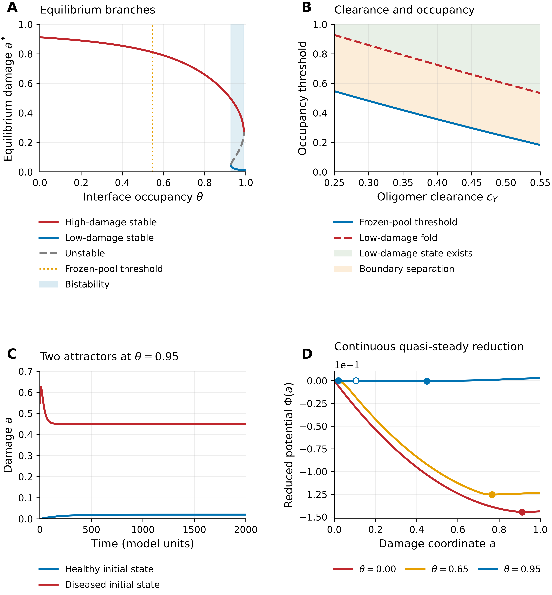

**Figure 4.** Equilibria and the reduced damage landscape. (A) Stable high-damage and low-damage branches, unstable saddle branch and shaded bistable interval. The dotted line is the frozen-pool comparator; no inset covers the curves. (B) Frozen-pool comparator and numerically refined low-damage fold versus cY; shading denotes existence of a low-damage state, not guaranteed treatment success from every initial condition. (C) Full-node trajectories at θ = 0.95, extended to t = 2000. (D) Continuous quasi-steady potentials with Φ(0) = 0. Filled markers indicate stable roots and the open marker the saddle. These are reduced potentials, not thermodynamic energies. Detailed folds are shown separately in Supplementary Fig. S1.

Analytic fast-variable elimination gives a continuous reduced potential at θ = 0, 0.65 and 0.95 (Fig. 4D). The low-damage intervals previously unresolved by multidimensional root searches are not physical gaps. The reduced equilibrium damages are 0.9123 at θ = 0, 0.7659 at θ = 0.65, and 0.02015, 0.10489 and 0.44987 at θ = 0.95. The first and last roots at θ = 0.95 are stable; the middle root is unstable in the complete-node Jacobian. Because the blue potential has a much smaller vertical scale, its local double-well detail is easier to see from the roots and the independently supplied fold enlargement than from the shared vertical scale alone.

Full-node integration from low- and high-damage initial conditions converges to 0.0202 and 0.4499 at θ = 0.95 by t = 2000 (Fig. 4C). In contrast, the low-start trajectory is only approximately 0.009 at t = 120 and has not yet reached its equilibrium. This distinction illustrates why finite-horizon endpoints require care even on the low-damage branch. The two folds and the distinct attraction basins provide the mathematical basis for history dependence; clinical irreversibility is not inferred from this reversible damage variable.

### 4.4 Occupancy, accumulation and assessment horizon

The Langmuir relation translates sustained free concentration into interface occupancy, but the infusion accumulation timescale delays the arrival at that occupancy (Fig. 5A). At onset t = 8, increasing passivation reduces the oligomer peak from approximately 0.319 to 0.018 and its [0,40] integral from 4.41 to 0.59 over the sampled dose range (Fig. 5B,C). These reductions quantify a molecular-burden effect even when damage remains elevated later.

Damage responses differ sharply between t = 40 and t = 200 (Fig. 5D). A sampled dose with θ* ≈ 0.83 gives mean damage approximately 0.19 at t = 40 but 0.64 at t = 200. The late-horizon occupancy midpoint is around 0.89 for this protocol; it is a response-summary value and should not be conflated with the constant-occupancy node fold. Binding history, seeded damage, network heterogeneity and the evaluation horizon all distinguish the two calculations. Proximity to a saddle-node can produce critical slowing, but the observed long transients are also affected by the 50-unit accumulation timescale; no universal scaling law for critical slowing was established here.

High infusion can improve the passivation-only endpoint if started sufficiently early. At t = 0, uP = 0.2 gives mean damage 0.093 at t = 200, whereas uP = 0.1 gives 0.209. At onset t = 8, even uP = 1.0 leaves damage approximately 0.182. These are dimensionless protocol comparisons, not feasible human doses, toxicity limits or loading-dose recommendations. They show that the eventual occupancy plateau alone does not determine the response.

**Figure 5.** Passivation response. (A) Equilibrium Langmuir occupancy. (B) Oligomer trajectories at four infusion rates. (C) Peak and integrated oligomer burdens over [0,40], each normalised to its value at the lowest sampled dose. (D) Damage at t = 40 and t = 200 against sustained occupancy; the vertical fold comparator comes from the constant-occupancy node analysis. Except where noted in the text, treatment begins at t = 8.

### 4.5 Combination response and intervention onset

At the reference infusion, passivation trajectories with onsets t = 0, 8, 16 and 24 approach similar late damages near 0.66 despite large differences at t = 40 (Fig. 6A). Clearance enhancement approaches approximately 0.72 across onset times (Fig. 6B). The reference three-parameter combination produces lower late damage: approximately 0.058, 0.093, 0.114 and 0.136 for onsets 0, 8, 16 and 20. It remains below the operational 0.14 benchmark through onset 20 on the sampled grid. Later starts leave larger residual damage. These outcomes indicate sustained suppression over the simulated 200-unit horizon; asymptotic global arrest of the network has not been proven.

The cY–uP landscape with baseline cZ shows a compensatory boundary at damage 0.15 (Fig. 6C). This is an operational endpoint contour rather than a node bifurcation curve. It incorporates accumulation and the network initial conditions and should not be identified point-for-point with Fig. 4B. The grid and the treatment-window protocol also differ in cZ. Treating them as identical would overstate the quantitative correspondence between the panels.

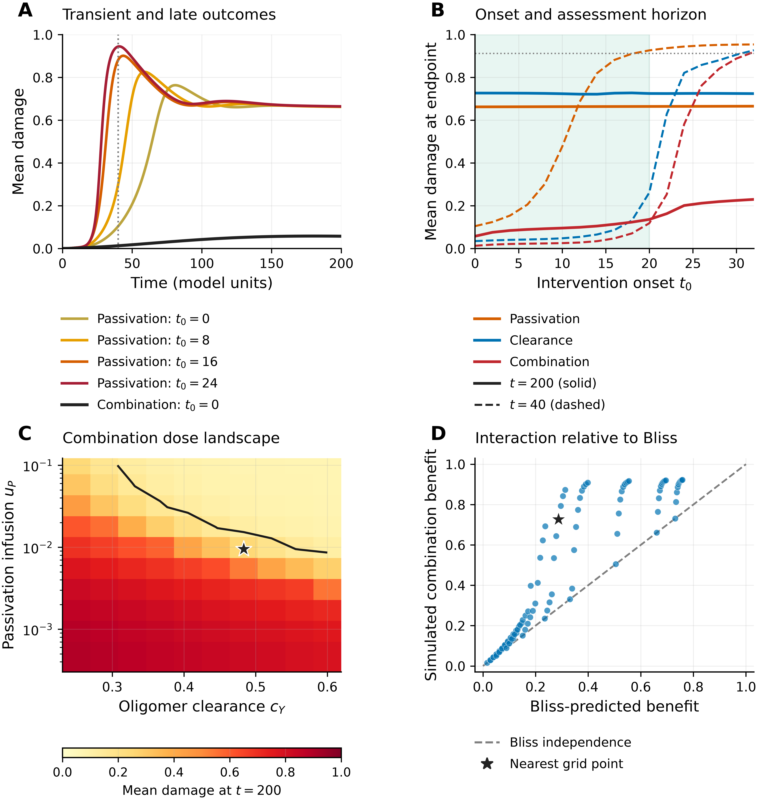

**Figure 6.** Intervention timing and combination design. (A) Passivation onset trajectories and the three-parameter combination from onset zero; the dotted line marks t = 40. (B) Damage at t = 40 (dashed) and t = 200 (solid); the faint onset band marks combination damage ≤ 0.14 through onset 20. (C) Damage at t = 200 across the cY–uP grid, with cZ fixed at 0.114; the dark contour is damage 0.15 and the star marks the sampled coordinate nearest the nominal reference. Sustained occupancy follows θ* = uP/(cP KD + uP). The horizontal colourbar is independent of panel D. (D) Simulated benefit versus Bliss prediction using dose-matched single-agent controls; the dashed line is independence. The star is the nearest sampled coordinate, not the exact Table 2 intervention. All grid interventions start at t = 8; panels A and B additionally enhance cZ to 0.20 under clearance and combination treatment.

With exactly matched single-agent controls, 90% of the 100 grid points have positive Bliss excess (tolerance 10⁻⁶), with mean excess 0.153. Points at baseline clearance have zero excess up to numerical error. At the sampled coordinate nearest the nominal reference, cY = 0.4833 and uP = 0.009501, the single-agent benefits are 0.235 and 0.068; the predicted benefit is 0.287, the simulated benefit 0.727 and the excess 0.440. At the exact nominal coordinate cY = 0.50 and uP = 0.012, with cZ still at 0.114, separate simulations give late damage 0.157, predicted benefit 0.326, simulated benefit 0.828 and excess 0.502. The lower damage of 0.093 in Table 2 belongs to a different protocol that also enhances fibril clearance.

The positive departure from Bliss is consistent with nonlinear interaction between local aggregation suppression and clearance. A fold provides a plausible mechanism for a large response when two individually insufficient changes are combined. Demonstrating that this is the unique mechanism would require matched dynamical ablations and alternative interaction reference models. The present result supports a model-specific combination hypothesis, rather than a claim that monotherapy can never work or that a drug pair will be synergistic in patients.

### 4.6 Sensitivity and synthetic recovery

The largest PRCC magnitudes arise from monomer production λ₀ and clearance cX, approximately 0.65–0.87 across the measured outcomes (Fig. 7; Table 3). Secondary nucleation kₛ and oligomer clearance cY are important local kinetic controls. Damage gain ηY increases terminal damage but can reduce peak oligomer burden, because greater damage subsequently reduces supply. Network-coupling parameters DY and ηN have smaller aggregate effects in this sampling design, with |PRCC| ≤ 0.11. The nominal DY association with the timing metric is approximately −0.11 (p ≈ 0.034), so an assertion that all network effects are nonsignificant would be incorrect. These findings are conditional on the uncertainty ranges, endpoint definitions and fixed untreated protocol.

Parameter uncertainty generates a broad damage ensemble: the 5th–95th percentile interval at t = 40 spans approximately 0.003–0.984. This is an uncertainty propagation exercise over assumed parameter ranges, rather than a distribution of patient outcomes. Timing distributions reach the observation horizon because some trajectories never cross the damage threshold. Screening local kinetics therefore appears useful for this model, but spatial coupling and treatment-specific binding sensitivities require different experiments.

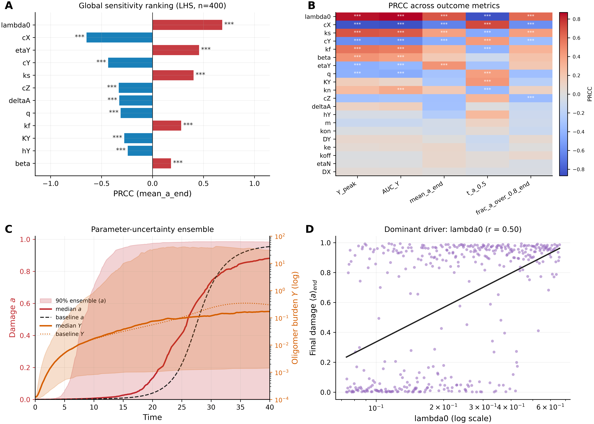

**Figure 7.** Global sensitivity and uncertainty. (A) PRCC ranking for terminal damage. (B) PRCC across five outcomes. Significance labels use nominal, unadjusted two-sided p-values. (C) Ensemble 5th–95th percentile bands for oligomer and damage, with baseline trajectories. (D) Monomer-production parameter versus terminal damage. The uncertainty ensemble describes sampled model parameters and does not estimate clinical variability.

The synthetic benchmark recovers all six fitted parameters within 10.9% of their generating values (Fig. 8; Table 4). This verifies recovery in one controlled setting with directly observed model-state summaries. The local ηY–KY correlation is approximately 0.56, consistent with coupling between toxicity scale and gain. Local uncertainty intervals are relatively narrow, but their width reflects the scaled least-squares curvature and does not validate the discarded profile-likelihood interpretation. The available 12 independent parameter draws using the local marginal standard errors are shown only as a descriptive spread, not a calibrated 95% prediction interval. Biomarker mapping, repeated-noise recovery, out-of-sample prediction and noise-consistent profiling are needed before the model could support individual calibration.

**Figure 8.** Synthetic recovery and local uncertainty. (A) Noisy synthetic observations, fitted oligomer and damage trajectories and the descriptive spread of 12 independent marginal Gaussian parameter draws. Fibril observations also enter fitting. (B) True and recovered parameter values. (C) Local log-Gaussian intervals derived from the reported standard errors, best fits and generating values; these are not validated profile-likelihood intervals. (D) Correlations from the local Gauss–Newton covariance. Neither the correlation matrix nor one recovery experiment establishes structural identifiability or frequentist coverage.

## 5. Discussion

The model connects a molecular occupancy hypothesis to a nonlinear disease-progression abstraction. Its most useful distinction is between reducing surface activity, creating a low-damage attractor and reaching that attractor under a finite accumulation schedule. The frozen-pool calculation explains how surface reactivity and removal enter the same amplification loop, but the full equilibrium analysis is required to locate the two folds. The late-horizon simulations then show how a favourable equilibrium structure can still fail to protect an initially damaged seed when occupancy accumulates slowly. These observations identify experimental quantities that a simple endpoint comparison would miss.

The contribution complements existing aggregation, neuron-interaction and connectome models [20,21,22,23,24,25,26,27,28]. It does not establish that previous models lack local aggregation kinetics, or that hub-related effects are absent in human disease. Here, strong local amplification and endpoint saturation limit the information contained in aggregate damage, while graph distance helps organise regional onset. The generated connectome and seeded initial conditions are useful controls for mechanism exploration but cannot reproduce clinical staging by themselves. A model calibrated to observed biomarkers could yield different parameter rankings, spatial patterns and intervention thresholds.

Surface targeting has experimental support, including BRICHOS inhibition of secondary nucleation [19]. The common occupancy acting on both elongation and secondary nucleation is nevertheless a substantial simplification: fibril ends and lateral surfaces are distinct binding targets, and inhibitors that redirect or remodel aggregates need additional states [15,16,17,18]. The model also omits tau, inflammation, vascular effects and pharmacokinetic barriers. Its reaction terms do not enforce peptide-mass stoichiometry, and its reversible damage index does not describe irreversible neuronal counts. These assumptions constrain the biological interpretation of both apparent recovery and the magnitude of combination benefit.

Several direct tests follow. At matched free concentrations, one can measure surface occupancy and separate effects on nucleation and elongation. At matched eventual occupancy, varying the accumulation profile tests the predicted timing dependence. Combining surface inhibition with independently measured clearance perturbations tests whether a large response persists under dose-matched single-agent controls and multiple interaction reference models. Experiments should measure oligomer exposure as well as fibril mass, because lower fibril burden alone need not imply lower toxicity. Translation of the 0.9282 and 0.9902 occupancies requires kinetic calibration; these numerical values are properties of the reference working point, not universal biological constants.

The uncertainty analysis remains preliminary. PRCC is a global screening tool under assumed parameter ranges, and node-wise nominal p-values do not account for spatial dependence. The fitting exercise has no external validation cohort and directly observes state summaries that clinical biomarkers measure only indirectly. Formal identifiability analysis, heteroscedastic-likelihood fitting, jointly optimised profiles and repeated-noise experiments would strengthen calibration claims. Additional graph realisations, fixed-size topology controls and alternative transport normalisations would clarify how much of the onset organisation depends on the present network construction. These are substantive tests needed for stronger biological prediction, rather than matters of presentation.

## 6. Conclusions

Explicit interface occupancy produces a tractable mechanism for suppressing surface-mediated aggregation in a network model. The q = 1 reduction permits continuous equilibrium reconstruction and identifies a bistable interval between occupancies 0.9282 and 0.9902 at the reference parameter set. Short- and late-horizon damage responses differ substantially, and combined passivation and clearance achieves greater late suppression than either reference intervention alone. Matched-dose Bliss comparisons describe the interaction within the simulated landscape. The appropriate interpretation is a quantitative hypothesis about occupancy, clearance and treatment history, to be tested with mass-resolved kinetics, biomarker calibration and external data.

## Funding

This research received no specific grant from any funding agency in the public, commercial or not-for-profit sectors.

## Competing interests

The authors declare no competing interests.

## Data and code availability

Source code, configuration files, numerical checks and the data underlying the revised figures are provided at https://github.com/Nanoer-Wang/ad-graph-model. The revised analysis is versioned separately from the original results. The repository records the exact scripts for fast-variable elimination, fold refinement, matched-dose Bliss analysis and figure generation. No patient data were used in this study.

## References

1. Hardy JA, Higgins GA. Alzheimer's Disease: The Amyloid Cascade Hypothesis. Science. 1992;256(5054):184-185. doi: 10.1126/science.1566067.
2. Karran E, Mercken M, Strooper BD. The amyloid cascade hypothesis for Alzheimer's disease: an appraisal for the development of therapeutics. Nat Rev Drug Discov. 2011;10(9):698-712. doi: 10.1038/nrd3505.
3. Blennow K, de Leon MJ, Zetterberg H. Alzheimer's disease. Lancet. 2006;368(9533):387-403. doi: 10.1016/s0140-6736(06)69113-7.
4. Jack CR Jr., Bennett DA, Blennow K, Carrillo MC, Dunn B, Haeberlein SB, et al. NIA‐AA Research Framework: Toward a biological definition of Alzheimer's disease. Alzheimers Dement. 2018;14(4):535-562. doi: 10.1016/j.jalz.2018.02.018.
5. Chiti F, Dobson CM. Protein Misfolding, Functional Amyloid, and Human Disease. Annu Rev Biochem. 2006;75(1):333-366. doi: 10.1146/annurev.biochem.75.101304.123901.
6. Knowles TPJ, Vendruscolo M, Dobson CM. The amyloid state and its association with protein misfolding diseases. Nat Rev Mol Cell Biol. 2014;15(6):384-396. doi: 10.1038/nrm3810.
7. Knowles TPJ, Waudby CA, Devlin GL, Cohen SIA, Aguzzi A, Vendruscolo M, et al. An Analytical Solution to the Kinetics of Breakable Filament Assembly. Science. 2009;326(5959):1533-1537. doi: 10.1126/science.1178250.
8. Arosio P, Knowles TPJ, Linse S. On the lag phase in amyloid fibril formation. Phys Chem Chem Phys. 2015;17(12):7606-7618. doi: 10.1039/c4cp05563b.
9. Cohen SIA, Linse S, Luheshi LM, Hellstrand E, White DA, Rajah L, et al. Proliferation of amyloid-β42 aggregates occurs through a secondary nucleation mechanism. Proc Natl Acad Sci U S A. 2013;110(24):9758-9763. doi: 10.1073/pnas.1218402110.
10. Meisl G, Kirkegaard JB, Arosio P, Michaels TCT, Vendruscolo M, Dobson CM, et al. Molecular mechanisms of protein aggregation from global fitting of kinetic models. Nat Protoc. 2016;11(2):252-272. doi: 10.1038/nprot.2016.010.
11. Sevigny J, Chiao P, Bussière T, Weinreb PH, Williams L, Maier M, et al. The antibody aducanumab reduces Aβ plaques in Alzheimer’s disease. Nature. 2016;537(7618):50-56. doi: 10.1038/nature19323.
12. van Dyck CH, Swanson CJ, Aisen P, Bateman RJ, Chen C, Gee M, et al. Lecanemab in Early Alzheimer’s Disease. N Engl J Med. 2023;388(1):9-21. doi: 10.1056/nejmoa2212948.
13. Budd Haeberlein S, Aisen PS, Barkhof F, Chalkias S, Chen T, Cohen S, et al. Two Randomized Phase 3 Studies of Aducanumab in Early Alzheimer's Disease. J Prev Alzheimers Dis. 2022;9(2):197-210. doi: 10.14283/jpad.2022.30.
14. Sims JR, Zimmer JA, Evans CD, Lu M, Ardayfio P, Sparks J, et al. Donanemab in Early Symptomatic Alzheimer Disease: The TRAILBLAZER-ALZ 2 Randomized Clinical Trial. JAMA. 2023;330(6):512-527. doi: 10.1001/jama.2023.13239.
15. Härd T, Lendel C. Inhibition of Amyloid Formation. J Mol Biol. 2012;421(4-5):441-465. doi: 10.1016/j.jmb.2011.12.062.
16. Porat Y, Abramowitz A, Gazit E. Inhibition of Amyloid Fibril Formation by Polyphenols: Structural Similarity and Aromatic Interactions as a Common Inhibition Mechanism. Chem Biol Drug Des. 2006;67(1):27-37. doi: 10.1111/j.1747-0285.2005.00318.x.
17. Bieschke J, Russ J, Friedrich RP, Ehrnhoefer DE, Wobst H, Neugebauer K, et al. EGCG remodels mature α-synuclein and amyloid-β fibrils and reduces cellular toxicity. Proc Natl Acad Sci U S A. 2010;107(17):7710-7715. doi: 10.1073/pnas.0910723107.
18. Ehrnhoefer DE, Bieschke J, Boeddrich A, Herbst M, Masino L, Lurz R, et al. EGCG redirects amyloidogenic polypeptides into unstructured, off-pathway oligomers. Nat Struct Mol Biol. 2008;15(6):558-566. doi: 10.1038/nsmb.1437.
19. Cohen SIA, Arosio P, Presto J, Kurudenkandy FR, Biverstål H, Dolfe L, et al. A molecular chaperone breaks the catalytic cycle that generates toxic Aβ oligomers. Nat Struct Mol Biol. 2015;22(3):207-213. doi: 10.1038/nsmb.2971.
20. Puri IK, Li L. Mathematical Modeling for the Pathogenesis of Alzheimer's Disease. PLoS One. 2010;5(12):e15176. doi: 10.1371/journal.pone.0015176.
21. Bertsch M, Franchi B, Marcello N, Tesi MC, Tosin A. Alzheimer's disease: a mathematical model for onset and progression. Math Med Biol. 2017;34(2):193-214. doi: 10.1093/imammb/dqw003.
22. Dayeh MA, Livadiotis G, Elaydi S. A discrete mathematical model for the aggregation of β-Amyloid. PLoS One. 2018;13(5):e0196402. doi: 10.1371/journal.pone.0196402.
23. Seeley WW, Crawford RK, Zhou J, Miller BL, Greicius MD. Neurodegenerative Diseases Target Large-Scale Human Brain Networks. Neuron. 2009;62(1):42-52. doi: 10.1016/j.neuron.2009.03.024.
24. Zhou J, Gennatas ED, Kramer JH, Miller BL, Seeley WW. Predicting Regional Neurodegeneration from the Healthy Brain Functional Connectome. Neuron. 2012;73(6):1216-1227. doi: 10.1016/j.neuron.2012.03.004.
25. Buckner RL, Sepulcre J, Talukdar T, Krienen FM, Liu H, Hedden T, et al. Cortical Hubs Revealed by Intrinsic Functional Connectivity: Mapping, Assessment of Stability, and Relation to Alzheimer's Disease. J Neurosci. 2009;29(6):1860-1873. doi: 10.1523/jneurosci.5062-08.2009.
26. Raj A, Kuceyeski A, Weiner M. A Network Diffusion Model of Disease Progression in Dementia. Neuron. 2012;73(6):1204-1215. doi: 10.1016/j.neuron.2011.12.040.
27. Jucker M, Walker LC. Propagation and spread of pathogenic protein assemblies in neurodegenerative diseases. Nat Neurosci. 2018;21(10):1341-1349. doi: 10.1038/s41593-018-0238-6.
28. Fornari S, Schäfer A, Jucker M, Goriely A, Kuhl E. Prion-like spreading of Alzheimer’s disease within the brain’s connectome. J R Soc Interface. 2019;16(159):20190356. doi: 10.1098/rsif.2019.0356.
29. Young AL, Marinescu RV, Oxtoby NP, Bocchetta M, Yong K, Firth NC, et al. Uncovering the heterogeneity and temporal complexity of neurodegenerative diseases with Subtype and Stage Inference. Nat Commun. 2018;9(1):4273. doi: 10.1038/s41467-018-05892-0.
30.  , Vogel JW, Young AL, Oxtoby NP, Smith R, Ossenkoppele R, et al. Four distinct trajectories of tau deposition identified in Alzheimer’s disease. Nat Med. 2021;27(5):871-881. doi: 10.1038/s41591-021-01309-6.
31. Sperling RA, Aisen PS, Beckett LA, Bennett DA, Craft S, Fagan AM, et al. Toward defining the preclinical stages of Alzheimer's disease: Recommendations from the National Institute on Aging‐Alzheimer's Association workgroups on diagnostic guidelines for Alzheimer's disease. Alzheimers Dement. 2011;7(3):280-292. doi: 10.1016/j.jalz.2011.03.003.
32. Jansen WJ, Ossenkoppele R, Knol DL, Tijms BM, Scheltens P, Verhey FRJ, et al. Prevalence of Cerebral Amyloid Pathology in Persons Without Dementia: A Meta-analysis. JAMA. 2015;313(19):1924-1938. doi: 10.1001/jama.2015.4668.
33. Desikan RS, Ségonne F, Fischl B, Quinn BT, Dickerson BC, Blacker D, et al. An automated labeling system for subdividing the human cerebral cortex on MRI scans into gyral based regions of interest. Neuroimage. 2006;31(3):968-980. doi: 10.1016/j.neuroimage.2006.01.021.
34. Watts DJ, Strogatz SH. Collective dynamics of ‘small-world’ networks. Nature. 1998;393(6684):440-442. doi: 10.1038/30918.
35. Braak H, Braak E. Neuropathological stageing of Alzheimer-related changes. Acta Neuropathol. 1991;82(4):239-259. doi: 10.1007/bf00308809.
36. Ossenkoppele R, Schonhaut DR, Schöll M, Lockhart SN, Ayakta N, Baker SL, et al. Tau PET patterns mirror clinical and neuroanatomical variability in Alzheimer’s disease. Brain. 2016;139(Pt 5):1551-1567. doi: 10.1093/brain/aww027.
37. Marino S, Hogue IB, Ray CJ, Kirschner DE. A methodology for performing global uncertainty and sensitivity analysis in systems biology. J Theor Biol. 2008;254(1):178-196. doi: 10.1016/j.jtbi.2008.04.011.

## Tables

**Table 1.** Model parameters, baseline values and interpretation. All values are in dimensionless model units; the reference parameterisation is a working point selected to illustrate the qualitative phenomenology of sporadic AD, not a fitted physiological set.

| Symbol | Meaning | Baseline | Notes |
|---|---|---|---|
| λ0 | Monomer production rate | 0.22 | Damage-modulated (Eq. 1) |
| β | Failed-clearance feedback strength | 4.5 | Maximum supply at a = 0.389 |
| cX | Monomer clearance | 0.28 | Reference monomer scale Xs = λ0/cX = 0.786 |
| kn | Primary-nucleation rate | 0.008 | Order m = 2 (cooperative) |
| m | Nucleation order | 2.0 | |
| ks | Secondary-nucleation coefficient | 1.5 | Surface-catalysed; dominant oligomer source |
| q | Secondary-nucleation order in Z | 1.0 | |
| ke | Elongation coefficient | 0.03 | Surface-catalysed monomer → fibril |
| cY | Oligomer clearance | 0.25 | Target of clearance therapy |
| kf | Oligomer-to-fibril conversion | 0.06 | |
| cZ | Fibril clearance | 0.114 | |
| DX, DY | Monomer / oligomer transport | 0.03, 0.06 | Row-normalised burden mixing |
| KY | Toxicity threshold (Hill) | 0.12 | |
| hY | Hill coefficient | 4.0 | Ultrasensitive toxicity response |
| ηY | Toxicity-to-damage rate | 0.30 | |
| ηN | Nonlocal damage transmission | 0.15 | Network-weighted |
| δa | Damage repair rate | 0.01 | Slowest timescale in the model |
| kon, koff | Passivator on/off rates | 2.0, 0.30 | KD = koff/kon = 0.15 |
| cP | Passivator decay | 0.02 | P* = uP/cP |
| uP | Passivator infusion | 0 (untreated) | Set by passivation therapy |

**Table 2.** Reference interventions from onset t = 8. Peak and integrated oligomer burdens use [0,40]. Damage at t = 200 is a late endpoint rather than a demonstrated asymptotic limit. Parameter schedules are specified in Section 3.3. Values are rounded from the archived simulation tables.

| Strategy | Ypeak | AUCY to 40 | Damage at 40 | Damage at 200 |
|---|---|---|---|---|
| Untreated | 0.346 | 4.735 | 0.955 | 0.912 |
| Passivation | 0.080 | 1.467 | 0.302 | 0.663 |
| Clearance enhancement | 0.028 | 0.662 | 0.044 | 0.725 |
| Primary nucleation inhibition | 0.294 | 2.408 | 0.848 | 0.911 |
| Propagation inhibition | 0.352 | 4.761 | 0.954 | 0.912 |
| Combination | 0.014 | 0.448 | 0.024 | 0.093 |

**Table 3.** PRCC sensitivity ranking (top eight parameters by |PRCC| for terminal damage; n = 400). *p* < 0.05 for all entries shown; full matrix in Fig. 7B and the archived PRCC table; p-values are nominal and unadjusted.

| Rank | Parameter | PRCC (⟨a⟩end) | Direction |
|---|---|---|---|
| 1 | λ0 (monomer production) | +0.68 | increases damage |
| 2 | cX (monomer clearance) | −0.65 | decreases damage |
| 3 | ηY (toxicity-to-damage gain) | +0.46 | increases damage |
| 4 | cY (oligomer clearance) | −0.44 | decreases damage |
| 5 | ks (secondary nucleation) | +0.40 | increases damage |
| 6 | cZ (fibril clearance) | −0.33 | decreases damage |
| 7 | δa (damage repair) | −0.33 | decreases damage |
| 8 | q (secondary-nucleation order) | −0.31 | decreases damage |

**Table 4.** Synthetic benchmark recovery. SE is the local Gauss–Newton standard error from output-scaled least squares; it is descriptive and does not establish calibrated coverage.

| Parameter | Generating value | Best fit | Local SE | Recovery error |
|---|---|---|---|---|
| kn | 0.011 | 0.01097 | 0.000566 | -0.3% |
| ks | 2.1 | 2.217 | 0.102 | +5.6% |
| ke | 0.045 | 0.0469 | 0.00377 | +4.2% |
| cY | 0.18 | 0.1997 | 0.0153 | +10.9% |
| etaY | 0.42 | 0.4115 | 0.0172 | -2.0% |
| KY | 0.09 | 0.08745 | 0.00324 | -2.8% |

## Supplementary material

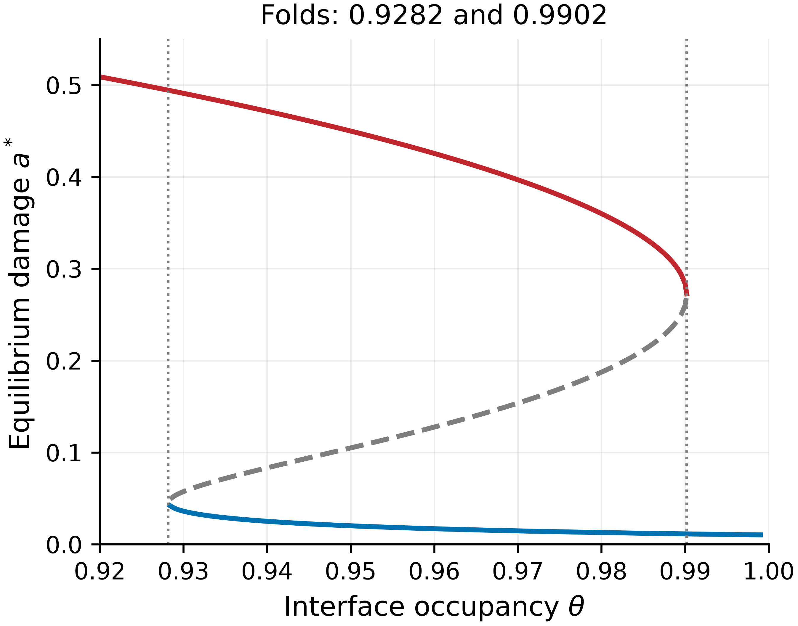

**Figure S1.** Enlargement of the complete-node equilibrium branches near the two folds. Dotted vertical lines mark θ = 0.928210 and θ = 0.990198. Stable low- and high-damage branches coexist between them and are separated by the unstable branch. This independently plotted enlargement leaves the main Fig. 4 curves unobscured.
